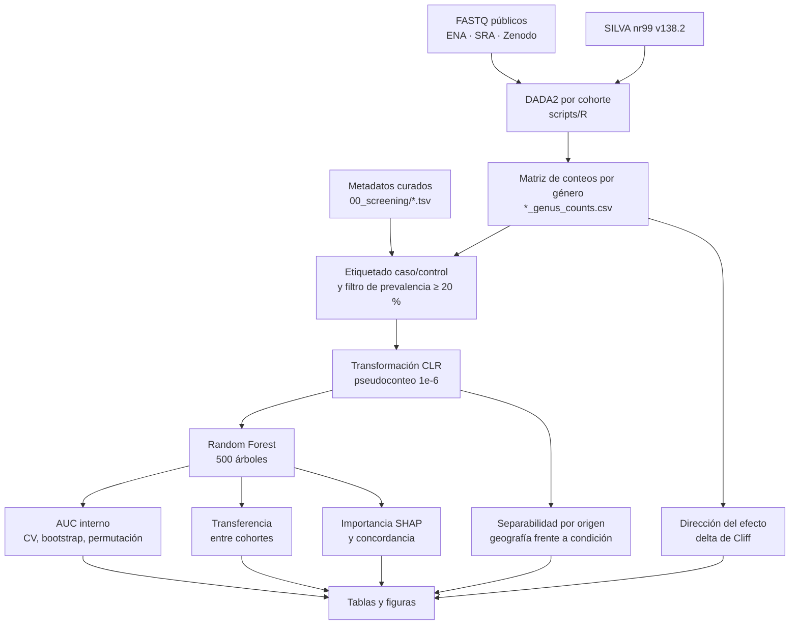
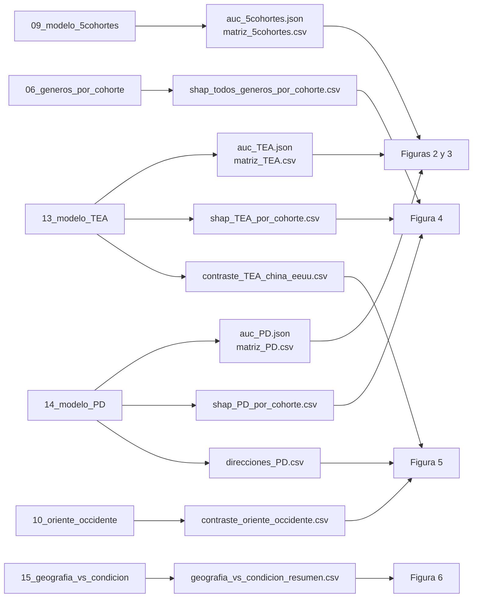

# Heterogeneidad geográfica de biomarcadores de microbioma intestinal

[](https://doi.org/10.5281/zenodo.24374407)

Código de procesamiento y análisis del manuscrito *Geographic heterogeneity of gut
microbiome biomarkers across neurological conditions: sub-national discordance in
ten cohorts from eleven cities in six countries*.

El proyecto reprocesa con un flujo común diez cohortes públicas de secuenciación del
gen 16S rRNA y evalúa si los géneros bacterianos que discriminan casos de controles
en una población conservan su valor en otra.

| Brazo | Condición | Cohortes | Ciudades | Países | Muestras |
|---|---|:---:|:---:|---|:---:|
| Alzheimer | Enfermedad de Alzheimer | 5 | 6 | China, Turquía, Italia | 563 |
| TEA | Trastorno del espectro autista | 3 | 3 | China, EE. UU. | 450 |
| Parkinson | Enfermedad de Parkinson | 2 | 2 | Finlandia, Rumanía | 172 |
| **Total** | | **10** | **11** | **6** | **1.185** |

> [!IMPORTANT]
> El repositorio contiene solo código. Para ejecutarlo hacen falta los FASTQ públicos,
> la base SILVA y las **tablas de metadatos de `00_screening/`**, que no se incluyen y
> que ningún script de este repositorio genera. Consulte
> [Datos de entrada](#datos-de-entrada).

## Contenido

- [Flujo general](#flujo-general)
- [Inicio rápido](#inicio-rápido)
- [Requisitos](#requisitos)
- [Datos de entrada](#datos-de-entrada)
- [Cohortes y procesamiento](#cohortes-y-procesamiento)
- [Métodos estadísticos](#métodos-estadísticos)
- [Scripts](#scripts)
- [Figuras y dependencias](#figuras-y-dependencias)
- [Reproducibilidad](#reproducibilidad)
- [Licencia y cita](#licencia-y-cita)

## Flujo general



## Inicio rápido

Los comandos se ejecutan desde la raíz del repositorio, con los datos ya colocados
según [Datos de entrada](#datos-de-entrada).

**1. Procesar las secuencias.** Cada ejecución trata una sola cohorte.

```bash
# Alzheimer (V3-V4)
for c in Li Ling Zhuang Turquia Italia; do Rscript scripts/R/dada2_AD_china.R "$c"; done

# TEA (V4, single-end)
for c in Dan Xiamen Caltech; do Rscript scripts/R/dada2_TEA_v4.R "$c"; done

# Parkinson (V3-V4)
for c in Finlandia Rumania; do Rscript scripts/R/dada2_PD.R "$c"; done
```

Revise `<cohorte>_track.csv` antes de continuar: los scripts recomiendan ajustar los
parámetros si algún paso pierde más del 50 % de las lecturas.

**2. Ejecutar los modelos principales.** `09`, `13` o `14` deben ejecutarse antes que
`06`, `10`, `15` y `21` a `23`, que no crean los directorios de salida.

```bash
python3 scripts/py/09_modelo_5cohortes.py        # Alzheimer
python3 scripts/py/13_modelo_TEA.py              # TEA
python3 scripts/py/14_modelo_PD.py               # Parkinson
python3 scripts/py/15_geografia_vs_condicion.py  # origen frente a condición
python3 scripts/py/06_generos_por_cohorte.py     # SHAP Alzheimer, entrada de la figura 4
python3 scripts/py/10_oriente_occidente.py       # contraste regional Alzheimer
```

**3. Ejecutar los análisis de sensibilidad.**

```bash
Rscript scripts/R/dada2_TEA_paired.R Xiamen
Rscript scripts/R/dada2_TEA_paired.R Caltech
python3 scripts/py/21_comparar_paired.py   # Tabla S7
python3 scripts/py/23_transfer_paired.py   # Tabla S7
python3 scripts/py/22_sensibilidad.py      # Tabla S6
```

**4. Generar las figuras.**

```bash
python3 scripts/py/18_figura1A.py
python3 scripts/py/19_figura1B.py
python3 scripts/py/17b_figuras.py
```

Los resultados quedan en `_crosscohort/` y las figuras, en PNG y PDF, en `_figuras/`.

## Requisitos

| Componente | Versión | Paquetes |
|---|---|---|
| R | 4.4.2 | `dada2` 1.34, `Biostrings`, `ShortRead`, `vegan` |
| Python | 3.12 | `numpy`, `pandas`, `scipy`, `scikit-learn`, `shap`, `matplotlib`, `cartopy` |
| Referencia | SILVA nr99 v138.2 | [`silva_nr99_v138.2_toSpecies_trainset.fa.gz`](https://zenodo.org/records/14169026) |

```bash
Rscript install_packages.R
python3 -m pip install -r requirements.txt
```

| Paquete | Uso |
|---|---|
| `dada2` | Filtrado, inferencia de ASV, fusión, quimeras y taxonomía |
| `Biostrings`, `ShortRead` | Búsqueda y recorte de cebadores, lectura de FASTQ |
| `vegan` | Lo carga `dada2_TEA_v4.R`, que falla si no está instalado, aunque no llama a sus funciones |
| `scikit-learn` | Random Forest, validación cruzada y AUC |
| `scipy` | Mann-Whitney y correlación de Spearman |
| `shap` | Importancia de los géneros |
| `matplotlib`, `cartopy` | Figuras y mapa |

> [!WARNING]
> Si `shap` no está instalado, los scripts continúan y usan la importancia nativa de
> Random Forest. El resultado ya no es comparable con el análisis basado en SHAP.

## Datos de entrada

Los scripts esperan esta estructura bajo la raíz `~/Documents/MicrobiomeRadar_Research`:

```text
MicrobiomeRadar_Research/
├── _reference/silva_nr99_v138.2_toSpecies_trainset.fa.gz
├── 01_TEA_Neurodivergent/<cohorte>/
├── 02_Parkinson_Neurodegenerative/<cohorte>/
├── 03_Alzheimer_Neurodegenerative/<cohorte>/
│   ├── 00_screening/      metadatos curados (entrada)
│   ├── 01_raw/            FASTQ (entrada)
│   ├── 02_processed/      salidas de DADA2
│   └── tmp_dada2/         ficheros intermedios
├── _crosscohort/          resultados de los análisis
└── _figuras/              figuras finales
```

Para usar otra ubicación sin modificar los scripts, cree un enlace simbólico:

```bash
ln -s /ruta/a/los/datos ~/Documents/MicrobiomeRadar_Research
```

Los identificadores de descarga de cada cohorte figuran en la Tabla 1 del manuscrito.
Los FASTQ deben llamarse `<muestra>_1.fastq.gz` y `<muestra>_2.fastq.gz`, con dos
excepciones: Dan usa `<muestra>.fastq.gz` y Rumanía usa
`<muestra>_R1_001.fastq.gz` y `<muestra>_R2_001.fastq.gz`.

### Tablas de metadatos

Son ficheros separados por tabuladores situados en `<cohorte>/00_screening/`.

| Cohorte | Fichero | Columna de unión | Columna de grupo | Caso | Control |
|---|---|---|---|---|---|
| Li | `mapa_heces.tsv` | `run_accession` | `grupo` | `AD` | `NC` |
| Ling | `ena_PRJNA633959.tsv` | `run_accession` | `library_name` | empieza por `AD` | empieza por `C` |
| Zhuang | `meta_554111.tsv` | `run_accession` | `sample_alias` | empieza por `AD` | empieza por `C` |
| Turquía, Estambul | `ena_PRJNA734525.tsv` | `run_accession` | `library_name` | `AD` + dígitos | `C` + dígitos |
| Turquía, Kayseri | `ena_PRJNA734525.tsv` | `run_accession` | `library_name` | `ADH` + dígitos | `CK` + dígitos |
| Italia | `mapa_baseline.tsv` | `run` | `grupo` | `AD` | `Control` |
| Dan | `mapa_dan.tsv` | `run` | `grupo` | `ASD` | `Control` |
| Xiamen | `mapa_xiamen.tsv` | `run` | `grupo` | `ASD` | `Control` |
| Caltech | `mapa_caltech.tsv` | `run` | `grupo` | `ASD` | `Control` |
| Finlandia | `mapa_finlandia.tsv` | `run` | `grupo` | `PD` | `Control` |
| Rumanía | `mapa_rumania.tsv` | `muestra` | `grupo` | `PD` | `Control` |

Las muestras con otras etiquetas se excluyen. `mapa_heces.tsv` también selecciona las
muestras fecales de Li antes de DADA2. `03_model.py` usa además
`meta_554111_full.tsv`, con las columnas `sample_name`, `age` y `sex`, para la línea
base demográfica de Zhuang.

## Cohortes y procesamiento

| Brazo | Argumento | Directorio | Ciudad | n | Región | Lecturas | Cebadores | `truncLen` |
|---|---|---|---|:---:|---|---|---|:---:|
| Alzheimer | `Li` | `03d_Li2019_Shanghai_China` | Shanghái | 90 | V3-V4 | Pareadas | 338F/806R, se recortan | 260/200 |
| Alzheimer | `Ling` | `03g_Ling2021_Lishui_China` | Lishui | 171 | V3-V4 | Pareadas | 341F/785R, se recortan | 255/195 |
| Alzheimer | `Zhuang` | `03h_Zhuang2019_Chongqing_China` | Chongqing | 86 | V3-V4 | Pareadas | 338F/806R, se recortan | 260/200 |
| Alzheimer | `Turquia` | `03i_Yildirim2022_Turkey` | Estambul | 62 | V3-V4 | Pareadas | Ya recortados | 230/225 |
| Alzheimer | `Turquia` | `03i_Yildirim2022_Turkey` | Kayseri | 63 | V3-V4 | Pareadas | Ya recortados | 230/225 |
| Alzheimer | `Italia` | `03k_Italia_PRJEB89799` | Brescia | 91 | V3-V4 | Pareadas | Ya recortados | 270/260 |
| TEA | `Dan` | `01f_Dan_Nanjing` | Nanjing | 285 | V4 | Single-end | Sin paso de recorte | 145 |
| TEA | `Xiamen` | `01g_Xiamen` | Xiamen | 83 | V4 | Forward | Sin paso de recorte | 145 |
| TEA | `Caltech` | `01h_Caltech_USA` | Pasadena\* | 82 | V4 | Forward | Sin paso de recorte | 145 |
| Parkinson | `Finlandia` | `02e_Finlandia` | Helsinki\* | 133 | V3-V4 | Pareadas | 341F/785R, se recortan | 280/250 |
| Parkinson | `Rumania` | `02f_Rumania` | Iași\* | 39 | V3-V4 | Pareadas | 341F/785R, se recortan | 275/230 |

\* Ciudad no declarada en los metadatos; se indica la sede de la institución
responsable. Turquía es una sola cohorte con dos centros, analizados por separado, y
por eso diez cohortes dan once unidades geográficas.

| Etapa | Parámetros |
|---|---|
| Recorte de cebadores | Por secuencia con `vmatchPattern`, hasta 2 discrepancias; exige ambos cebadores y al menos 50 pb restantes |
| Filtrado, lecturas pareadas | `maxN=0`, `maxEE=c(2,5)`, `truncQ=2`, `rm.phix=TRUE` |
| Filtrado, TEA single-end | `truncLen=145`, `maxN=0`, `maxEE=2`, `truncQ=2`, `rm.phix=TRUE` |
| Sensibilidad TEA pareada | `truncLen=c(145,140)`, `maxEE=c(2,5)`, `minOverlap=12` |
| Inferencia | `learnErrors(randomize=TRUE)` y `dada` por muestra |
| Fusión | `mergePairs(minOverlap=12)` |
| Quimeras | `removeBimeraDenovo(method="consensus")` |
| Taxonomía | `assignTaxonomy(tryRC=TRUE)` con SILVA |
| Agregación | Suma de ASV por género; se descartan los ASV sin género asignado |

## Métodos estadísticos

### Preparación de los datos

La abundancia relativa se calcula sobre los géneros seleccionados, los ceros se
sustituyen por el pseudoconteo $10^{-6}$ y cada muestra se transforma con CLR:

$$
\mathrm{CLR}(x_{ij}) = \ln x_{ij} - \frac{1}{D}\sum_{k=1}^{D}\ln x_{ik}
$$

En los modelos por brazo se conservan los géneros presentes en todas las cohortes del
brazo y con prevalencia de al menos 20 % en cada una.

### Modelo y evaluación

| Elemento | Configuración |
|---|---|
| Clasificador | Random Forest, 500 árboles, `max_features="sqrt"`, `class_weight="balanced"` |
| AUC interno | Validación cruzada estratificada de 10 particiones, 20 repeticiones |
| IC 95 % | Bootstrap percentil, 1.000 remuestreos, sobre las predicciones de una partición |
| Valor p | 300 permutaciones de etiquetas, con 100 árboles y una partición de 10 |
| Transferencia | Entrenamiento con toda la cohorte A y evaluación en la cohorte B |
| Importancia | Media de \|SHAP\| en 20 semillas, calculada sobre los datos de entrenamiento |
| Concordancia | Spearman entre rankings y solapamiento del top 20 |
| Semilla | 42 como base; las repeticiones usan `42 + r` |

La diagonal de cada matriz de transferencia contiene el AUC interno. El resto de las
celdas contiene el AUC externo.

### Geografía frente a condición

`15_geografia_vs_condicion.py` compara tres tareas de clasificación en cada brazo,
con validación cruzada de hasta 10 particiones y 5 repeticiones:

| Prueba | Pregunta |
|---|---|
| A | ¿Se distingue caso de control dentro de una cohorte? |
| B | ¿Se distingue la cohorte de origen usando solo controles? |
| C | ¿Se distingue la cohorte de origen usando solo casos? |

### Dirección del efecto

El tamaño de efecto es el delta de Cliff entre casos y controles, calculado sobre
abundancias relativas: $\delta = P(a > c) - P(a < c)$.

| Categoría | Criterio | Scripts |
|---|---|---|
| Sin efecto («plano») | \|δ\| < 0,10 | `04`, `09` |
| Candidato | \|δ\| ≥ 0,30 y p < 0,05 en al menos 2 cohortes | `04` |
| Inversión regional | Signo opuesto, \|δ\| ≥ 0,10 en ambas regiones e IC bootstrap (500) sin solapamiento | `10`, `13` |
| Inversión entre cohortes | Signo opuesto y \|δ\| ≥ 0,10 en ambas | `14` |
| Transversal | Mismo signo, \|δ\| ≥ 0,10 y p < 0,05 en ambas | `13`, `14` |

Los valores p proceden de pruebas de Mann-Whitney bilaterales.

### Análisis de sensibilidad

| Análisis | Qué varía | Script | Salida |
|---|---|---|---|
| Pseudoconteo | $10^{-7}$, $10^{-6}$, $10^{-5}$, $10^{-4}$ en las 11 unidades | `22` | Tabla S6 |
| Modo de lectura | Single-end frente a pareado en Xiamen y Caltech | `21` | Tabla S7 |
| Transferencia por modo | Xiamen ↔ Caltech en ambos modos | `23` | Tabla S7 |

En `21` y `22` la prevalencia se evalúa dentro de cada cohorte, no en el conjunto común
del brazo.

## Scripts

### Procesamiento en R

| Script | Cohortes | Función |
|---|---|---|
| `dada2_AD_china.R` | `Li`, `Ling`, `Zhuang`, `Turquia`, `Italia` | Flujo V3-V4 del brazo Alzheimer, incluidas las cohortes no chinas |
| `dada2_TEA_v4.R` | `Dan`, `Xiamen`, `Caltech` | Flujo V4 single-end, común a las tres cohortes |
| `dada2_TEA_paired.R` | `Xiamen`, `Caltech` | Reprocesamiento pareado; escribe en `02_processed_paired/` |
| `dada2_PD.R` | `Finlandia`, `Rumania` | Flujo V3-V4 del brazo Parkinson |

Cada cohorte produce `<cohorte>_genus_counts.csv`, `_track.csv` y `_seqtab.rds`. Los
flujos principales añaden `_taxa.rds`, `_sessionInfo.txt` y los PDF `_calidad` y
`_errores`.

### Análisis en Python

Las rutas de salida son relativas a `_crosscohort/`.

| Script | Papel | Qué hace | Salidas |
|---|---|---|---|
| `09_modelo_5cohortes.py` | Principal | Modelos, transferencia, separabilidad y direcciones en Alzheimer | `auc_5cohortes.json`, `transfer_matrix/matriz_5cohortes.csv`, `transfer_matrix/transferencia_5cohortes.csv`, `direcciones_5cohortes.csv` |
| `13_modelo_TEA.py` | Principal | Igual para TEA, con SHAP y contraste China-EE. UU. | `auc_TEA.json`, `transfer_matrix/matriz_TEA.csv`, `transfer_matrix/transferencia_TEA.csv`, `shap_TEA_por_cohorte.csv`, `contraste_TEA_china_eeuu.csv` |
| `14_modelo_PD.py` | Principal | Igual para Parkinson, con SHAP y direcciones | `auc_PD.json`, `transfer_matrix/matriz_PD.csv`, `transfer_matrix/transferencia_PD.csv`, `shap_PD_por_cohorte.csv`, `direcciones_PD.csv` |
| `15_geografia_vs_condicion.py` | Principal | Pruebas A, B y C en los tres brazos | `geografia_vs_condicion_resumen.csv`, `geografia_vs_condicion_detalle.csv` |
| `06_generos_por_cohorte.py` | Principal | SHAP con todos los géneros de cada cohorte china y AUC según número de géneros | `shap_todos_generos_por_cohorte.csv`, `auc_por_numero_features.csv` |
| `10_oriente_occidente.py` | Principal | Contraste China frente a Turquía e Italia | `direcciones_oriente_occidente.csv`, `contraste_oriente_occidente.csv` |
| `03_model.py` | Complementario | Modelos de las cohortes chinas (5 particiones × 20) y línea base demográfica | `auc_internos_china.json`, `importancia_china.csv`, `transfer_matrix/matriz_transferencia_china.csv`, `transfer_matrix/transferencia_detalle.csv` |
| `04_auditoria_biomarcadores.py` | Complementario | Contraste con las direcciones publicadas | `auditoria_direccion_biomarcadores.csv`, `candidatos_nuevos_biomarcadores.csv` |
| `07_control_lote.py` | Complementario | Profundidad, riqueza y separabilidad entre cohortes chinas | Solo consola |
| `08_turquia_centros.py` | Complementario | Estambul frente a Kayseri dentro de un mismo estudio | `shap_turquia_por_centro.csv`, `turquia_centros_mapa.csv` |
| `21_comparar_paired.py` | Sensibilidad | Single-end frente a pareado | `M3_single_vs_paired.csv` |
| `22_sensibilidad.py` | Sensibilidad | Efecto del pseudoconteo | `m2_sensibilidad_escala.csv` |
| `23_transfer_paired.py` | Sensibilidad | Transferencia según el modo de lectura | `M3_transferencia_por_modo.csv` |
| `17b_figuras.py` | Figuras | Figuras 2 a 6 | `_figuras/` |
| `18_figura1A.py` | Figuras | Diagrama de cribado, con cifras fijadas en el script | `_figuras/` |
| `19_figura1B.py` | Figuras | Mapa, con coordenadas y tamaños fijados en el script | `_figuras/` |

Varios resultados solo se imprimen en consola. Para conservarlos, redirija la salida,
por ejemplo: `python3 scripts/py/07_control_lote.py | tee control_lote.log`.

## Figuras y dependencias



| Figura | Contenido | Fichero en `_figuras/` | Script |
|---|---|---|---|
| 1A | Cribado de cohortes | `Figura_1A_flujo_cribado` | `18_figura1A.py` |
| 1B | Mapa de localizaciones | `Figura_1B_mapa` | `19_figura1B.py` |
| 2 | AUC interno por cohorte | `Figura_2_rendimiento_interno` | `17b_figuras.py` |
| 3 | Matrices de transferencia | `Figura_3_transferencia` | `17b_figuras.py` |
| 4 | Concordancia de importancia | `Figura_4_concordancia` | `17b_figuras.py` |
| 5 | Tamaño de efecto por región | `Figura_5_contraste_regional` | `17b_figuras.py` |
| 6 | Origen frente a condición | `Figura_6_origen_vs_condicion` | `17b_figuras.py` |

`17b_figuras.py` omite cualquier panel cuyo fichero de entrada no exista. En la
Figura 5 imprime un aviso en consola por cada brazo omitido y, si el CSV no trae la
columna `transversal`, la calcula con el mismo criterio que `13` y `14`.

## Reproducibilidad

- Los pasos aleatorios usan la semilla 42 como base.
- Los flujos principales de R guardan `sessionInfo()` para cada cohorte.
- Las versiones de los paquetes de Python no están fijadas, por lo que versiones
  distintas pueden producir diferencias en los resultados.

Tiempos orientativos en un equipo de sobremesa de ocho núcleos:

| Etapa | Tiempo |
|---|---|
| DADA2 por cohorte | 20 min a 3 h, según el número de muestras y el equipo |
| Modelado por condición | 20–40 min |
| Sensibilidad al pseudoconteo | 20 min |
| Figuras | 2 min |

## Licencia y cita

**Licencia:** [MIT](LICENSE).

**Cita:** si utiliza este código, cite el artículo *Geographic heterogeneity of gut
microbiome biomarkers across neurological conditions: sub-national discordance in
ten cohorts from eleven cities in six countries* (referencia completa pendiente de
publicación) y el código:

Tello Meryk, J. *Geographic heterogeneity of gut microbiome biomarkers across
neurological conditions: analysis code*. Zenodo.
[https://doi.org/10.5281/zenodo.24374407](https://doi.org/10.5281/zenodo.24374407)
